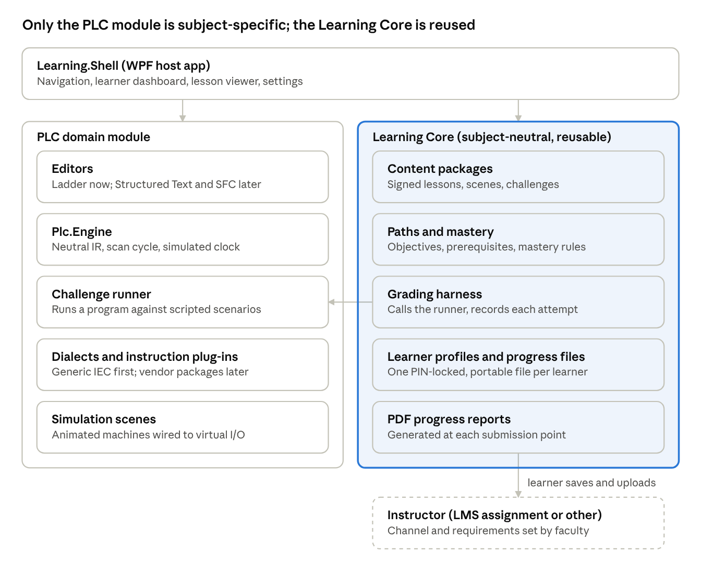

# PLC+ — the plan: decisions and why

The source is **Ron's technical specification**, `docs/SPECIFICATION.pdf` (2026-11-04, 15 pages, 13 sections). This file
records where we follow it, where we differ and why, and Ron's decisions as they are made. The work itself is in
`docs/DEVELOPMENT-PLAN.md`.

## What PLC+ is

A Windows program that takes a learner from electrical and logic basics to advanced PLC programming, with **simulated
machines in place of real hardware**. It is the home, self-paced half of a PLC course. The lab, with real PLCs, is the other
half. It is for students, for faculty in the grant training cohort learning PLCs before they teach them, and for
instructors, who receive progress reports.

Three rules from the spec (section 2) are never bent:
1. **All learning works offline.** No account and no internet.
2. **Progress leaves the program only as files the learner chooses to save and hand in.** The program sends nothing.
3. **One installation, many learners**, each with their own PIN-protected progress file that they can carry to another
   computer.

## The architecture (spec section 3)

Two layers in one program:
- **The Learning Core** has nothing to do with PLCs. It handles content, mastery, progress, learners and reports.
- **The PLC module** supplies the engine, the editors and the scenes.

Their only link is the challenge runner (`Learning.Core.IChallengeRunner`). An architecture test fails the build if
`Learning.Core` ever references a `Plc.*` assembly.

| Project | What it holds |
|---|---|
| `src/Learning.Core` | The shared learning engine: grading contract, content, mastery, learners and progress files (built); reports (to come) |
| `src/Learning.Shell` | The WPF program (exe `PLCPlus.exe`). Phase 0: the first-look window |
| `src/Plc.Engine` | The neutral program model (JSON), the scan cycle on a simulated clock, forcing, faults, validation |
| `src/Plc.Dialects.Iec` | Generic IEC 61131-3: TON/TOF/TP, CTU/CTD/CTUD, compare, math, MOVE, bit logic |
| `src/Plc.Scenes` | Scenes as JSON: push buttons, pilot lights and motors so far |
| `src/Plc.Grading` | The challenge harness: scenarios, assertions, invariants, hidden tests, constraints |
| `content/plcplus-foundations` | The first content: the motor station scene, its challenge, two example programs |
| `tests/` | `Plc.Engine.Tests` (97, with the 11 reference programs in `tests/golden/`) and `Learning.Core.Tests` (3, including the architecture test) |

Projects still to come, from spec 11: `Plc.Editors`, `Reports.Pdf`, `Tools.ContentValidator`, `Tools.ReportVerifier`.

## Decisions

| # | Decision | Who / when | Why |
|---|---|---|---|
| D1 | **We stay with what we know works for our software** where the spec offers a newer choice | Ron, 2026-11-04 | Every one of Ron's Store programs ships this way, and the release steps, WACK and Partner Center are proven |
| D2 | **Packaging: MSIX on the Microsoft Store**, like the other programs, not Velopack | Ron, 2026-11-04 (D1) | Same packaging, certification and updates as the family. A lab's machine-wide install uses MSIX provisioning (`Add-AppxProvisionedPackage`), so every account on a lab PC gets it |
| D3 | **Ladder and scenes drawn with WPF's own shapes and text, not SkiaSharp** | Ron, 2026-11-04 (D1) | A Skia canvas is one picture to a screen reader. WPF elements carry their own names, so NFR-6 (keyboard and screen reader) holds in the editor itself |
| D4 | **Progress files encrypted with .NET's built-in cryptography, not SQLCipher** | Ron, 2026-11-04 (D1) | No native library to ship or certify. AES-GCM with a key from the PIN (PBKDF2); the file layout is D13 |
| D5 | **The Learning Core is the shared engine for all our learning software**: reporting results, submitting them, and several learners on one machine | Ron, 2026-11-04 | Ron: *"These are all part of the engine that will be common to this learning software and the other software we produce."* Built here first as `Learning.Core`. Once a second program uses it, it becomes a versioned package in `C:\nuget-local`, as AI Manager is |
| D6 | **Submission follows the Gamify+ games**: the final screen shows the grade, the progress and the learner's name, and the learner hands that in | Ron, 2026-11-04 | Ron: *"The current JavaScript games that we have created have worked well."* One progress snapshot gives several outputs: the PDF report (spec 9), a **signed result line** that pastes into any LMS, discussion or e-mail (like Gamify+'s `GP1\|name\|game\|8/10\|date\|code`), and sending it straight to the instructor. Together they make *"a submission path that works for all online platforms or direct submission of an assignment to the faculty"* |
| D7 | **Every module has Learn, Assess and Reference.** Its first page shows the modules that must come first (prerequisites), its learning outcomes and its topics | Ron, 2026-11-04 | Ron: *"We do not need to worry if we do not get it correct in the early software. We will have instructors of PLC courses reviewing the software and giving feedback on the flow."* This is the first shape; the instructors' review reshapes it |
| D8 | **Engine semantics are pinned by tests**, one or more per instruction, and the scan order is fixed: inputs → programs → outputs → clock | Spec 4.2, 4.5 | NFR-3: the same program and scenario always grade the same way |
| D9 | **The tests a learner cannot see report pass or fail only**, not what they check | Spec 7.2 | So a program cannot be fitted to the tests |
| D10 | **Name: PLC+** in front of a person; `PLCPlus` in code, folders and the exe | Ron, 2026-11-04 | The family's "+" naming; reserved in Partner Center by Ron (plan 11.1) |
| D11 | **Free on the Microsoft Store** | Ron, 2026-11-04 | As Gamify+ and the other learning programs |
| D12 | **Reports are signed two ways**: always with the computer's own key (not edited since), and also with the instructor's **class code** when the learner entered one (came from that class) | Ron, 2026-11-04 | Gamify+'s Verify page works because the teacher holds the key; the computer's key alone proves only that nothing was edited |
| D13 | **The progress file is a readable header plus one AES-GCM block of JSON**, not SQLite | Ron, 2026-11-04 | *"The files are not likely to get that large, JSON is the better choice."* Append-only attempts keep merging simple |
| D14 | **The lab PLC is Allen-Bradley.** The engine is compared against it, and Rockwell is the first vendor dialect | Ron, 2026-11-04 | Spec 4.5 and 4.4. Phase 1 stays Generic IEC; the AB differences (TON .PRE/.ACC/.DN, RTO) are noted in lessons |
| D15 | **Prerequisites are recommended, not enforced; lessons show in the program's own window; the main window has the family's layout** | Ron, 2026-11-04 | Plan 4.4, 4.5, 7.1 |
| D16 | **Ron signs the content when it is published** | Ron, 2026-11-04 | The key stays out of git; the program rejects unsigned packages |
| D17 | **No AI in Phase 1.** It comes back as a question only if the instructors' review shows it is needed | Ron, 2026-11-04 | NFR-2: no learner data leaves the computer |
| D18 | **Lab PCs are not reimaged, but learners must back up their files** | Ron, 2026-11-04 | The program asks for a backup and reminds them (plan 6.10) |
| D19 | **The grant's outcomes are written as we go**; no research analytics; **only the learner's name is required** on a report (ID, course, e-mail optional) | Ron, 2026-11-04 | The grant asks for faculty training on PLCs and student educational resources, and does not require research on outcomes |
| D21 | **An item's Example is a similar machine, not the exercise's own answer** | Ron, 2026-11-04 | Ron: *"the examples will be similar, but not the same."* Plan 9.7 |
| D22 | **How the learners' files work** (phase 6): one key per learner, made at random and kept wrapped twice (PIN, recovery code); every copy of a learner's file shares it, so copies merge, a backup opens with the PIN it was made with, and two sessions saving one file merge instead of overwriting. My program and the questions' answers are per learner. Removing a learner sends the file to the Recycle Bin. The settings (folder, lock time) are for the whole computer, in `%ProgramData%\PLCPlus\settings.json` | Claude, 2026-11-05, from spec 8 and D4, D13, D18 | Built in `Learning.Core.Learners` (subject-neutral). Five wrong PINs, then 30 s doubling to 30 min (the spec says only "a wait that grows"). For Ron to change if the instructors want otherwise |
| D23 | **How reports are signed and handed in** (phase 8): the PDF is drawn from the progress snapshot with **PDFsharp** (the family's PDF library, MIT; the spec named QuestPDF, whose licence the family avoids) and QRCoder. The snapshot goes inside the PDF; the program leaves a fixed-length place for the signature, signs the SHA-256 of the whole file with **this computer's key** (ECDSA P-256, made the first time a report is made, kept with Windows DPAPI in the data folder), and writes the signature into that place, as PDF signatures do; with a **class code** the same hash is also signed with it. The **result line** (`PLC1\|name\|point\|result\|date\|report ID\|code`, Gamify+'s shape) is signed with the class code, or with the report's signature. The QR holds the report ID and verification code as text (no web page). The verifier is in PLC+ (File menu and start screen) | Claude, 2026-11-05, from spec 9–10 and D6, D12, D19 | One changed byte, or an edit saved onto the end of the file, fails the check. The honest limit (spec 10) is printed on every report: the key is on the learner's computer, so it proves the file was not changed after it was made; the class code proves the class. For Ron to change |
| D20 | **Modules → items, each item with Learn, Example, Exercise and Reference tabs**, in the family's tree-and-tabs window; the items of a module build on each other, and each module shows the learner's status | Ron, 2026-11-04 | Ron: *"The overall interface will be similar to the Statistle/BMPFast and other interfaces and divided into modules."* Two levels, not the spec's three; all 12 modules in the tree; the machines become exercises (D7's Assess is the Exercise tab plus the module check) |

## How the engine works (built 2026-11-04)

- **A project** is JSON: tags (BOOL, INT, DINT, REAL, TIME, or a timer or counter type) and programs made of rungs.
- **A rung** is a tree. *Series* means power passes through each element in turn (AND); *parallel* means any branch passes
  it (OR). Contacts, coils and boxes sit inside. Every editor (ladder now, Structured Text and SFC later) produces this one
  tree.
- **A scan:** the machine's inputs are copied in, the programs run, the outputs are copied out, and the clock moves on
  exactly the scan time (10 ms by default). Time never comes from the wall clock.
- **Forcing** an input changes what the PLC sees; forcing an output changes what the machine gets, while the program's own
  value stays as it is.
- **Faults** (divide by zero so far) stop the PLC at the rung that caused them and turn its outputs off, as a real PLC does.
  Reset starts it again.
- **The validator** points to the exact rung and element (`Rung 2, element 1.1`) in words for a beginner. A program with
  errors does not run.
- **Live view:** the runtime records whether power flowed out of each element in the last scan.
- **Arrays and structures** (phase 1): `ARRAY[0..9] OF INT`, structures declared in the project, arrays of structures. Each
  element and member is stored on its own (`Pumps[2].Speed`); an index taken from a tag is worked out when it is used, and
  an index past the end stops the PLC with an index-out-of-range fault, as a real one does.
- **Breakpoints** are on rungs: running to one stops at the end of the first scan in which that rung passed power, so the
  whole machine can be seen at that moment.
- **Traces** record any tags after every scan. Their change log (one line per scan in which something changed) is what the
  reference programs in `tests/golden/` are held to, what the lab compares the Allen-Bradley PLC against
  (`docs/LAB-COMPARISON.md`), and how a failed test is replayed.

## The grader (built 2026-11-04)

A challenge is a JSON file:
- the brief and the scene;
- constraints: required or forbidden instructions, and the most rungs allowed;
- scenarios: timed button presses, checks at set times (`at 1.0 s, Motor is TRUE`), and things that must never happen
  (`Fill and Drain never both on`);
- points, a pass threshold, and hints in tiers.

Each scenario starts from a clean reset and runs headless on the simulated clock, far faster than real time (the three motor
scenarios, 5 simulated seconds, grade at the click of the button). The result names the failed check and when it failed, plus a SHA-256 fingerprint of the program.

## References

- `docs/SPECIFICATION.pdf` — Ron's technical specification (the source of every requirement ID: FR-1…13, NFR-1…9)
- `docs/DEVELOPMENT-PLAN.md` — phases and tasks
- `docs/MANUAL-TESTING.md` — Ron's hand-tests
- `docs/LAB-COMPARISON.md` — the Allen-Bradley comparison of the reference programs
- `..\USABILITY-CHECKLIST.md` — the usability rules every program meets
- `..\GamifyPlus\src\GamifyPlus.Core\Verify\` — the signed result line D6 builds on
